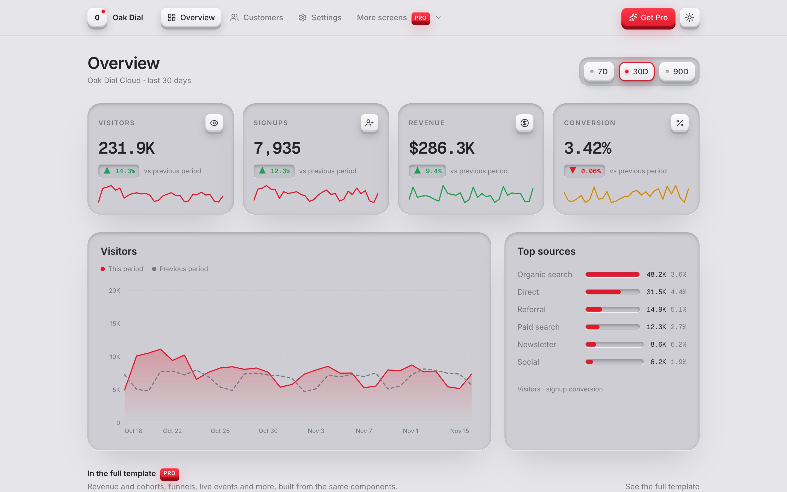

<div align="center">

# Oak Dial Lite

**A free SaaS analytics dashboard with a tactile, hardware-inspired look.**<br>
KPIs, traffic and customers, in light and dark. Built with [Thock UI](https://thock-ui.vercel.app).

[](LICENSE)


[**Full version demo**](https://thock-analytics-demo.vercel.app) · [**Thock UI**](https://thock-ui.vercel.app) · [**Get the full template**](https://thock-ui.vercel.app/templates/analytics)

<picture>
  <source media="(prefers-color-scheme: dark)" srcset=".github/assets/overview-dark.jpg">
  
</picture>

</div>

## At a glance

| | |
| --- | --- |
| **Screens** | 3: overview, customers, settings |
| **Looks** | Light and dark themes, works on phones and tablets |
| **Data** | 180 days of seeded demo metrics and 64 customers; the server and browser render the same numbers |
| **Charts** | Plain SVG. No chart library to learn or ship |
| **Stack** | Next.js 16 (App Router), React 19, Tailwind CSS v4, Radix UI, lucide-react, next-themes |
| **Licence** | MIT: use it for anything, including commercial projects |

## Quick start

```bash
git clone https://github.com/intellaralabs/thock-analytics-lite.git
cd thock-analytics-lite
npm install
npm run dev        # open http://localhost:3000
```

Other scripts: `npm run build`, `npm start`, `npm run lint`.

## Screens

| Route | What it shows |
| --- | --- |
| `/` | KPI cards (visitors, signups, revenue, conversion) with trend lines and change vs the previous period, a 7/30/90-day visitors chart against the previous period, and top traffic sources |
| `/customers` | 64 customers with search, status and plan filters, sortable columns, paging, row selection, bulk "mark churned" and CSV export |
| `/settings` | Profile, light/dark/system theme and notification switches |

## Project structure

```
app/                  layout.tsx (theme + state + shell) and one page per screen
components/ui/        Thock UI components (free, MIT; yours to edit)
components/lite/      app parts: shell, state provider, SVG charts, screens
data/analytics.ts     demo data and the types the UI expects
lib/format.ts         number, money, percent and date formatting
lib/links.ts          links to the full template; set showProPreviews = false to remove them all
styles/tactile.css    design tokens: colours, raised and recessed surfaces, LEDs
```

## Connect your own data

All state lives in `components/lite/analytics-provider.tsx`. Screens only call `useAnalytics()` (`customers`, `days`,
`setDays`, `updateCustomers`, `removeCustomers`).

1. Replace `daily` and `sources` in `data/analytics.ts` with rows from your warehouse or analytics API, keeping the
   `DayMetrics` shape (one row per day).
2. Load customers from your billing system or database instead of the generated list.
3. In the provider, send `updateCustomers` / `removeCustomers` to your API as well as to the reducer.

The charts in `components/lite/charts.tsx` are plain SVG, so you can restyle or replace them freely.

## Make it yours

The "More screens" menu, the preview pages, the overview teaser, the "Get Pro" button and the footer link to the full
template. One line in `lib/links.ts` switches them all off:

```ts
export const showProPreviews = false;
```

Then you can also delete `app/pro`, `data/pro-screens.ts`, `components/lite/pro-*.tsx` and `public/pro`. To restyle,
change the colour tokens in `styles/tactile.css`.

## Lite or full?

| | Lite (free) | [Full template](https://thock-ui.vercel.app/templates/analytics) |
| --- | :---: | :---: |
| Screens | 3 | 13 + sign-in |
| Overview with KPI cards and traffic chart | ✓ | ✓ |
| Customers table with filters and CSV export | ✓ | ✓ |
| Settings, light and dark, phone-ready | ✓ | ✓ |
| Customer detail with health and timeline | | ✓ |
| Revenue, MRR movements and cohort retention | | ✓ |
| Conversion funnels and live event stream | | ✓ |
| Report builder with saved reports | | ✓ |
| Team, billing and API keys | | ✓ |
| ⌘K command menu and toasts | | ✓ |
| Components | Free set | Free + Pro |
| Licence | MIT | Pro licence |

Try the full version: **[thock-analytics-demo.vercel.app](https://thock-analytics-demo.vercel.app)**

## Licence

[MIT](LICENSE) © Intellara Labs. Built with [Thock UI](https://thock-ui.vercel.app).
